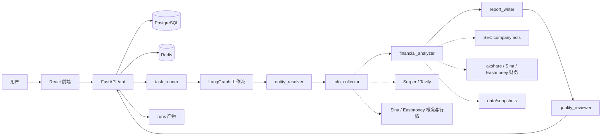

# 智慧投研 Agent（Agentic Research）

> 多市场公司研究自动化：输入公司名/代码，LangGraph 工作流完成实体解析、信息搜集、财务分析、报告撰写与质量审核，输出 7 章 Markdown 研究报告。
>
> 技术栈：**LangGraph + FastAPI + PostgreSQL + Redis + React + Ant Design + Prometheus**


---

## 项目简介

本项目面向 **A 股 / 港股 / 美股**，把“投研报告”拆成一条可观测、可降级、可评测的 Agent 工作流：

- 多市场实体解析：股票代码、公司名、中文/英文名称；
- 工具编排：搜索、公司概况、行情、SEC 财报、akshare/新浪/东财财务数据；
- 结构化报告：公司概览、业务与行业、近期新闻与舆情、财务分析、风险提示、投资结论、附录；
- 质量审核：检查章节完整性、指标数量与最终状态；
- 工程化：异步任务、进度查询、Redis 状态缓存、Prometheus 指标、React 前端；
- 可评测：21 项定量指标工装 + 本地数据快照，解决 akshare 不稳定导致的“今天有、明天没有”。

> 本项目仅用于技术学习与研究，**不构成任何投资建议**。数据来自公开接口，可能存在延迟、缺失或错误，请以交易所/公司官方披露为准。

---

## 当前评测结果（2026-10-25）

### 关键数字

| 指标 | 修复前 | 修复后（当前） |
|---|---|---|
| 30 家端到端 | 30/30 | **30/30**（95%CI 88.6–100） |
| 质量成功（`final_status=success`） | 13/30 | **30/30** |
| 150 字段准确率 | 72/150 = 48.0% | **149/150 = 99.33%**（95%CI 96.3–99.9） |
| 分市场字段准确率 | A 84.0% / HK 0.0% / US 60.0% | **A 98.0% / HK 100.0% / US 100.0%** |
| 单 LLM 基线（无工具） | 0/150（弃答 148/150） | **0/150（弃答 148/150）** |
| 工具成功率 | 89.0% | **97.13%**（338/348） |
| 故障降级 | 9/10 | **10/10** |
| 无效代码降级 | 2/3 | **3/3** |
| P50 / P95 延迟 | 75.80s / 126.36s | **58.42s / 82.93s** |
| 单份成本 | 待单价 | **待单价**（token 已采集） |
| 人工评分 17–20 | 未做 | **待人工** |

### 测试口径（简要）

- 样本：**30 家**，美股 10 / A 股 10 / 港股 10，全部非金融；
- 字段：**30 × 5 = 150**，`revenue / net_income / gross_margin / net_margin / operating_margin`；
- 评分：**报告层解析**，与同期真值比较，**容差 1%**；
- 真值：美股 = SEC 官方 XBRL；A/HK = 新浪/东财 vendor 参考值（**尚未完成官方年报 PDF 复核**）；
- 指标 1 是“流程成功”（5 section 非空 + 无 fatal），不等于质量；质量成功单独看 `final_status=success`；
- 指标 8/11/12（Tavily/yfinance/Finnhub）当前 provider 未启用，记 **N/A**，不记 0%；
- 指标 15 只差单价：30 份共 **in 532,346 / out 262,974 / cache 335,360 tokens**；
  按 ¥1/¥1/¥2 示例约 **¥0.035/份**（示例，不是结果）；
- 指标 17–20 需要 2 人 × 10 份 × 4 维盲评，当前为 **N/A**。

> 唯一剩余字段：`000333.SZ gross_margin` 25.26% vs 25.54%，相对差 1.1%，
> 是新浪/同花顺“营业成本”口径/四舍五入差异，不是取数或公式错误。

### 完整 21 项指标

<details>
<summary>点击展开 21 项结果</summary>

| 序号 | 指标 | 结果 | 备注 |
|---|---|---|---|
| 1 | 端到端成功 | 30/30 = 100%（CI 88.6–100） | `final_status=success` 30/30 |
| 2 | 无效代码降级 | 3/3 = 100%（CI 43.8–100） | `ZZZZZZ` / `999999.SH` / `88888.HK` |
| 3 | 报告完整率 | 30/30 = 100% | 5 个核心 section 均有实义内容 |
| 4 | 150 字段准确率 | 149/150 = 99.33%（CI 96.3–99.9） | 报告层；容差 1% |
| 5 | 分市场字段准确率 | A 49/50 = 98.0%；HK 50/50 = 100%；US 50/50 = 100% | 各 50 |
| 6 | 单 LLM 基线 | 0/150 = 0%（CI 0–2.5） | 弃答 148/150；无工具 |
| 7 | 工具成功率（总） | 338/348 = 97.13%（CI 94.8–98.4） | profile 33/33、SEC 10/10、akshare 20/20 |
| 8 | Tavily 成功率 | N/A | 当前 provider=serper；serper 247/255 |
| 9 | SEC EDGAR 成功率 | 10/10 = 100%（CI 72.2–100） | companyfacts |
| 10 | akshare 成功率 | 20/20 = 100%（CI 83.9–100） | 语义成功=返回有效数据 |
| 11 | yfinance 成功率 | N/A | 当前 provider=eastmoney |
| 12 | Finnhub 成功率 | N/A | key 未配置 |
| 13 | P50 延迟 | 58.42s（CI 55.68–62.87） | 端到端，n=30 |
| 14 | P95 延迟 | 82.93s（CI 65.46–93.61） | 端到端，n=30 |
| 15 | 单份成本 | 待单价 | in 532,346 / out 262,974 / cache 335,360 tokens |
| 16 | 故障降级 | 10/10 = 100%（CI 72.2–100） | 10 类故障注入 |
| 17 | 人工评分-完整性 | N/A（待人工） | 2 人 × 10 份 × 1–5 分 |
| 18 | 人工评分-事实一致性 | N/A（待人工） | 同上 |
| 19 | 人工评分-结构 | N/A（待人工） | 同上 |
| 20 | 人工评分-可 action 性 | N/A（待人工） | 同上 |
| 21 | Top 3 错误类型 | numeric_calc 1 | 000333 毛利率 1.1% 边界差 |

</details>

### 评测样本

<details>
<summary>点击展开 30 家样本</summary>

- **US**：AAPL、MSFT、GOOGL、AMZN、META、NVDA、TSLA、WMT、KO、PG
- **CN**：600519.SH、000858.SZ、000333.SZ、002415.SZ、600276.SH、000651.SZ、002714.SZ、002594.SZ、600887.SH、600900.SH
- **HK**：00700.HK、09988.HK、00941.HK、01810.HK、02020.HK、01093.HK、09618.HK、01024.HK、00981.HK、09888.HK

</details>

### 评测报告与原始数据

- [完整指标回收表](agentic_research/backend/tests/eval/results/指标回收表.md)
- [修复后复测结果（含前后对比）](agentic_research/backend/tests/eval/results/修复后复测结果.md)
- [首轮实测结果（修复前，用于定位问题）](agentic_research/backend/tests/eval/results/首轮实测结果解读.md)
- [测试方案 v2（口径/样本/真值/统计/执行）](agentic_research/docs/测试方案_定量指标_v2.md)
- [执行摘要（给负责人看的 2 页版）](agentic_research/docs/测试方案_执行摘要.md)
- [修复记录（11 项修复 + 验证）](agentic_research/docs/修复记录_2026-10-25.md)
- [150 行真值 CSV](agentic_research/backend/tests/eval/results/ground_truth.csv)
- [示例报告（AAPL）](report.md)

---

## 核心能力

- **多市场实体解析**：A 股代码/中文名、港股代码、美股 ticker/公司名；港股走新浪校验，A 股不在缓存时做实时校验，避免把无效代码当成有效实体。
- **五节点 LangGraph 工作流**：实体解析 → 信息搜集 → 财务分析 → 报告撰写 → 质量审核。
- **工具编排与降级**：搜索、公司概况、行情、SEC 财报、akshare/新浪/东财财务数据；单工具失败不影响整条链路。
- **结构化报告**：固定 7 章；5 个核心 section 必须非空；缺失数据明确标注，不编造。
- **本地数据快照**：财务/概况 30 天快照优先，实时失败回退旧快照并标记 `stale=True`；解决 akshare 限流/断连。
- **异步任务 + 前端**：任务创建、进度查询、报告查看/下载；React + Ant Design 仪表盘。
- **可观测**：Prometheus 指标（任务/节点/工具/LLM/缓存）、结构化 run 日志、中间产物落盘。
- **可评测**：21 项定量指标工装，支持端到端、基线、无效代码、10 类故障、字段评分与统计置信区间。

---

## 系统架构



### 工作流节点

| 节点 | 职责 | 主要数据源/工具 |
|---|---|---|
| `entity_resolver` | 把输入解析为 `Entity`（market/symbol/name/cik） | SEC ticker map、A 股列表 + 新浪校验、港股新浪 |
| `info_collector` | ReAct Agent 搜集概况/新闻/行情，输出 JSON | `search_web`、`get_company_profile`、`get_stock_quote` |
| `financial_analyzer` | 拉取财报，标准化并计算指标 | SEC companyfacts、akshare 同花顺/新浪、东财港股 |
| `report_writer` | 用结构化财务摘要生成 7 章 Markdown | LLM（DeepSeek）+ 报告 prompt |
| `quality_reviewer` | 检查章节/指标数量，给出最终状态 | 规则审核 |

---

## 目录结构

```text
③项目代码/
├─ agentic_research/
│  ├─ backend/
│  │  ├─ app/
│  │  │  ├─ adapters/        # A/HK/US 实体适配器
│  │  │  ├─ api/routes/      # auth / health / tasks
│  │  │  ├─ core/            # 配置、LLM、日志、Prometheus 指标
│  │  │  ├─ db/              # SQLAlchemy 异步会话
│  │  │  ├─ graph/           # LangGraph state/nodes/workflow
│  │  │  ├─ models/          # User / Task
│  │  │  ├─ prompts/         # 报告 prompt
│  │  │  ├─ Schemas/         # Pydantic 模型
│  │  │  ├─ services/        # 实体解析、任务执行、快照层
│  │  │  ├─ tools/           # 搜索/概况/行情/SEC/CN-HK 财务
│  │  │  └─ utils/           # 产物、run 日志
│  │  ├─ tests/
│  │  │  ├─ test_auth.py / test_tasks.py / test_workflow_mocked.py
│  │  │  ├─ test_snapshot.py
│  │  │  └─ eval/            # 21 项评测工装
│  │  ├─ data/               # 快照、ticker/股票列表缓存
│  │  ├─ Dockerfile
│  │  ├─ requirements.txt
│  │  ├─ pytest.ini
│  │  └─ .env.example
│  ├─ fronted/               # React + Vite + Ant Design（目录名为项目现状）
│  ├─ prometheus/
│  ├─ docs/                  # 测试方案/执行摘要/修复记录/快照说明
│  └─ docker-compose.yml
├─ data/                     # 根目录股票列表数据
├─ report.md                 # 示例报告（AAPL）
└─ README.md
```

> `fronted/` 是当前仓库实际目录名；如果重命名，请同步 `docker-compose.yml` 与构建脚本。

---

## 快速开始

### 方式 A：Docker Compose（推荐）

```powershell
cd agentic_research

# 1) 准备环境变量（不要提交 .env）
Copy-Item backend\.env.example backend\.env
# 编辑 backend\.env，至少填 DEEPSEEK_API_KEY；按需填 SERPER_API_KEY / TAVILY_API_KEY

# 2) 构建并启动
docker compose up -d --build

# 3) 访问
# 前端：http://localhost:3000
# API 文档：http://localhost:8000/docs
# 健康检查：http://localhost:8000/api/health
# Prometheus：http://localhost:9090
```

| 服务 | 端口 |
|---|---|
| 前端 | 3000 |
| 后端 API | 8000 |
| PostgreSQL | 5433（宿主机）→ 5432（容器） |
| Redis | 6379 |
| Prometheus | 9090 |

### 方式 B：本地开发

```powershell
cd agentic_research

# 1) 先起 PG/Redis（只起数据层）
docker compose up -d postgres redis

# 2) 后端
cd backend
conda create -n agentic python=3.11 -y
conda activate agentic
pip install -r requirements.txt
Copy-Item .env.example .env
# 本地运行时：POSTGRES_HOST=127.0.0.1、POSTGRES_PORT=5433、REDIS_HOST=127.0.0.1
# 至少填 DEEPSEEK_API_KEY
uvicorn app.main:app --reload --port 8000

# 3) 前端（新终端）
cd ../fronted
npm install
npm run dev
```

> `docker-compose.yml` 把 PostgreSQL 映射到宿主机 **5433**；`.env.example` 默认写 5432（容器内）。
> 本地跑后端时请改成 `POSTGRES_PORT=5433`，否则会连不上。

---

## 配置说明

完整模板见 `agentic_research/backend/.env.example`。**不要提交真实 key。**

| 变量 | 必填 | 说明 |
|---|---|---|
| `DEEPSEEK_API_KEY` | 是 | DeepSeek API key |
| `DEEPSEEK_BASE_URL` | 是 | 默认 `https://api.deepseek.com` |
| `DEEPSEEK_MODEL` | 是 | 默认 `deepseek-chat`；本项目实测使用 `deepseek-flash`，以账号可用模型为准 |
| `SEARCH_PROVIDER` | 是 | `serper`（实测）或 `tavily` |
| `SERPER_API_KEY` | 条件 | `SEARCH_PROVIDER=serper` 时必填 |
| `TAVILY_API_KEY` | 条件 | `SEARCH_PROVIDER=tavily` 时必填 |
| `STOCK_QUOTE_PROVIDER` | 否 | `eastmoney`（实测）/ `yfinance` / `finnhub` / `akshare` |
| `FINNHUB_API_KEY` | 否 | `STOCK_QUOTE_PROVIDER=finnhub` 时需要 |
| `SEC_USER_AGENT` | 是 | SEC 要求真实联系方式，如 `name email@example.com` |
| `POSTGRES_*` / `REDIS_*` | 是 | 数据库/缓存连接 |
| `HTTPS_PROXY` | 否 | 访问外部 API 的代理（国内网络可能需要） |
| `EDGAR_LOCAL_DATA_DIR` | 否 | SEC/edgar 缓存目录；建议指向项目内可写目录 `.edgar` |
| `DATA_SNAPSHOT_DIR` | 否 | 快照目录，默认 `data/snapshots` |
| `DATA_FORCE_LIVE` | 否 | `1` 时强制实时、跳过新鲜快照（预热脚本会用） |
| `SECRET_KEY` | 是 | JWT 签名密钥，生产环境必须改 |

> 如果 `~/.edgar` 不可写，SEC 相关调用会失败；建议：
> ```powershell
> $env:EDGAR_LOCAL_DATA_DIR="<项目绝对路径>\.edgar"
> ```

---

## 数据源与缓存策略

| 数据 | 默认策略 | 实时失败时 |
|---|---|---|
| A 股财务 | 30 天快照优先 | 同花顺 → 新浪财报 → 旧快照（`stale=True`） |
| 港股财务 | 30 天快照优先 | 东财 → 旧快照（`stale=True`） |
| 美股财务 | 30 天快照优先 | SEC companyfacts → 旧快照（`stale=True`） |
| 公司概况 | 30 天快照优先 | SEC/新浪/东财 → 旧快照 |
| 行情 | 实时（东财/新浪） | ≤1 天快照（`stale=True`） |
| 新闻 | 实时搜索 | 不缓存 |

- 快照目录：`agentic_research/backend/data/snapshots/`
- 每个工具结果带 `_data_meta`（`source / fetched_at / period_end / stale`）；
  报告附录会标注数据来源与抓取时间，`stale=true` 时明确写“非实时”。
- 主动刷新：
  ```powershell
  cd agentic_research/backend
  python scripts/prewarm_data.py --sample core          # 30 家
  python scripts/prewarm_data.py --symbols AAPL,600519.SH,00700.HK --only financials
  python scripts/seed_snapshots_from_eval.py            # 从已有评测原始数据灌快照
  ```
- 详细说明：[数据快照与降级](agentic_research/docs/数据快照与降级.md)

> 注意：财务数据是“最新披露期”，不是实时行情；行情/新闻会随抓取时间变化。

---

## API 一览

启动后打开 `http://localhost:8000/docs` 可直接调试。

| 方法 | 路径 | 说明 |
|---|---|---|
| GET | `/api/health` | DB/Redis 健康检查 |
| POST | `/api/register` | 注册，返回 JWT |
| POST | `/api/login` | 登录（OAuth2 表单：username/password） |
| GET | `/api/me` | 当前用户 |
| POST | `/api/tasks` | 创建投研任务，后台异步执行 |
| GET | `/api/tasks` | 任务列表 |
| GET | `/api/tasks/{id}` | 任务详情 |
| GET | `/api/tasks/{id}/status` | 轻量状态（优先 Redis） |
| GET | `/api/tasks/{id}/progress` | 节点进度 |
| GET | `/api/tasks/{id}/artifacts` | 中间产物列表 |
| GET | `/api/tasks/{id}/artifacts/{filename}` | 读取中间产物 |
| GET | `/api/tasks/{id}/report` | 获取报告 Markdown |
| GET | `/api/tasks/{id}/report/download` | 下载报告 |
| GET | `/metrics` | Prometheus 指标 |

示例（PowerShell 建议直接用 `/docs`）：

```bash
curl -X POST http://localhost:8000/api/register \
  -H "Content-Type: application/json" \
  -d '{"username":"demo","email":"demo@example.com","password":"password123"}'

curl -X POST http://localhost:8000/api/tasks \
  -H "Authorization: Bearer <token>" \
  -H "Content-Type: application/json" \
  -d '{"query":"AAPL"}'
```

---

## 评测工装与复现

### 目录

```text
agentic_research/backend/tests/eval/
├─ cli.py              # 命令行入口
├─ config.py           # 样本/字段/容差/价格/故障定义
├─ ground_truth.py     # 真值构建（SEC/新浪/东财）
├─ runner.py           # 30 家端到端
├─ baseline.py         # 单 LLM 基线
├─ invalid.py          # 3 个无效代码
├─ faults.py           # 10 类故障契约
├─ aggregate.py        # 21 项汇总 + Wilson/bootstrap
├─ text.py             # 报告解析/字段抽取
├─ test_parser.py      # 离线解析器单测
└─ results/            # 指标表/真值/原始运行
```

### 运行

```powershell
cd agentic_research/backend

# 可选：先刷新快照，避免 akshare 抖动
python scripts/prewarm_data.py --sample core

# 全量（约 60–90 分钟；会消耗 LLM token）
python -m tests.eval.cli all --sample core --gt --force

# 只重算指标（不重跑模型）
python -m tests.eval.cli aggregate
```

> 上表是**全量实时跑**的结果。快照层上线后，默认会优先读快照；
> 若要复现实时调用（并让指标 10 有 20 次 akshare 调用），先设置：
> ```powershell
> $env:DATA_FORCE_LIVE="1"
> ```
> 不强制实时时，财务/概况可能 0 次实时调用，指标 10 会显示 N/A，这是预期行为。

分步：

```powershell
python -m tests.eval.cli gt --sample core --force
python -m tests.eval.cli run --sample core --force
python -m tests.eval.cli invalid --force
python -m tests.eval.cli baseline --sample core --force
python -m tests.eval.cli faults --force
python -m tests.eval.cli aggregate
```

### 单元测试

```powershell
cd agentic_research/backend
pytest tests/test_snapshot.py tests/eval/test_parser.py -q
# 当前：13 passed
```

> 完整 `pytest` 需要 PostgreSQL/Redis；仅跑离线单测不需要外部服务。

---

## 已知问题与后续计划

### 已知问题

1. **人工评分 17–20 未完成**：需要 2 名评分者 × 10 份 × 4 维盲评，当前 N/A。
2. **指标 15 单价未配置**：token 已采集，成本需运行日账单单价；当前表内为“待单价”。
3. **A/HK 真值仍是 vendor 参考值**：尚未完成交易所年报 PDF 复核；最终交付前建议抽查 ≥20% 并标 `verified`。
4. **000333.SZ 毛利率边界差**：25.26% vs 25.54%，1.1%，是新浪/同花顺口径差异。
5. **搜索工具偶发参数错误**：少量 `Too many arguments to single-input tool search_web`，会触发 fallback；计划改 `StructuredTool` 单参数。
6. **快照 TTL**：财务/概况 30 天，行情 ≤1 天；需要定期 `prewarm_data.py`，否则会使用 stale 快照（报告会标注）。
7. **SEC ticker 缓存无 TTL**：新 ticker 可能解析不到；建议定期刷新 `sec_company_tickers.json`。
8. **本地健康检查**：`/api/health` 里 Redis host 写死为 `redis`，非 Docker 本地运行时可能显示 degraded（不影响任务执行）。

### Roadmap

- [ ] 官方年报 PDF 真值复核 + 人工评分 17–20
- [ ] 接入运行日 LLM 单价，补齐指标 15
- [ ] 搜索工具改 `StructuredTool`，消除重复参数错误
- [ ] 快照定时刷新 / CI 预热
- [ ] 更多市场与字段、报告导出 PDF/Word
- [ ] 前端截图与演示视频
- [ ] 测试覆盖率与 CI

---

## 安全与发布检查

- **不要提交 `agentic_research/backend/.env`**：里面是真实 API key。仓库只保留 `.env.example`。
- 如果曾经把 `.env` 推到 GitHub，请立即**轮换 DeepSeek/Serper/Tavily/Finnhub key**。
- 仓库根目录已提供 `.gitignore`，至少忽略：
  ```gitignore
  .env
  **/.env
  __pycache__/
  *.pyc
  node_modules/
  runs/
  logs/
  .edgar/
  agentic_research.tar.gz
  agentic_research/backend/data/snapshots/
  agentic_research/backend/tests/eval/results/runs/
  agentic_research/backend/tests/eval/results/app_runs/
  agentic_research/backend/tests/eval/results/runs_baseline/
  agentic_research/backend/tests/eval/results/runs_faults/
  agentic_research/backend/tests/eval/results/*.jsonl
  ```
- 测评证据建议保留：`指标回收表.md`、`metrics.json`、`ground_truth.csv`、`修复后复测结果.md`；
  原始 `runs/` 较大，可只保留汇总。
- `data/snapshots/` 默认**不提交**（`.gitignore` 已忽略），首次运行用 `prewarm_data.py` 生成；这样不会把 vendor 快照数据带进公开仓库。

---

## 贡献

欢迎 Issue / PR。提交前：

1. 确认没有提交任何 `.env` 或密钥；
2. 跑离线单测：`pytest tests/test_snapshot.py tests/eval/test_parser.py -q`；
3. 如果改了数据源/评测口径，请同步更新 `agentic_research/docs/测试方案_定量指标_v2.md` 与 `results/` 下的汇总。

---

## 致谢

- [LangGraph](https://github.com/langchain-ai/langgraph) / [LangChain](https://github.com/langchain-ai/langchain)
- [FastAPI](https://fastapi.tiangolo.com/) / [SQLAlchemy](https://www.sqlalchemy.org/) / [Redis](https://redis.io/)
- [React](https://react.dev/) / [Ant Design](https://ant.design/) / [Vite](https://vitejs.dev/)
- [akshare](https://github.com/akfamily/akshare)、[SEC EDGAR](https://www.sec.gov/edgar)、[Serper](https://serper.dev/)、[Tavily](https://tavily.com/)、[yfinance](https://github.com/ranaroussi/yfinance)

---

## License

本项目采用 **MIT License**，详见 [LICENSE](LICENSE)。

## 免责声明

本项目仅用于技术学习与研究，不构成任何投资建议。报告中的数据来自公开接口，可能存在延迟、缺失、口径差异或错误；请以交易所、公司公告与官方财报为准。使用第三方 API 产生的一切费用与合规责任由使用者自行承担。
